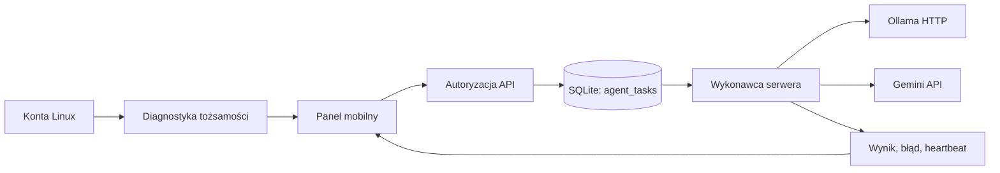

# Sterowanie agentami Bastilla

## Wdrożona wersja do przeglądu

Profile Aria, Alex, Astyria i Aurelius mają wspólny wykonawca zadań modelowych w procesie Express. Konto Linux i worker Python są osobnymi elementami. Heartbeat konta nie potwierdza dostępu do modelu, a odpowiedź modelu w serwerze nie potwierdza uprawnień konta Linux.

Kolejka obsługuje `queued → running → succeeded / failed / cancelled / interrupted`. Anulowanie jest dostępne również przed wykonaniem. SQLite przechowuje agenta, treść, priorytet, dostawcę, model, wynik, błąd i znaczniki czasu. Model i dostawca są ustalane przy przyjęciu zadania. Zmiana dostawcy w środowisku dotyczy nowych zadań.

- Maksymalnie 100 oczekujących lub wykonywanych zadań; treść do 8000 znaków, wynik do 32000.
- Priorytet 0–10, potem FIFO. Transakcja `BEGIN IMMEDIATE` obejmuje przyjęcie i atomowe pobranie zadania.
- Jeden aktywny wpis `running` na bazę, także przy wielu procesach serwera. Kolejka nie uruchamia równoległych zadań narzędziowych.
- Heartbeat co 5 s, dzierżawa 30 s, limit wywołania modelu 60 s. Wygasła dzierżawa oznacza `interrupted`. Nie ma automatycznego ponawiania przerwanych zadań.
- Klucz idempotencji zwraca wcześniejsze zadanie; inna treść pod tym samym kluczem jest odrzucana.
- Anulowanie przerywa lokalne żądanie. Spóźniony wynik nie może zmienić anulowanego wpisu. Zdalna usługa może nadal naliczyć koszt rozpoczętego wywołania.
- Sukces wymaga niepustej odpowiedzi wybranego modelu. Błąd usługi i brak klucza pozostają błędami.

API:

| Operacja | Ścieżka |
| --- | --- |
| Historia do 100 najnowszych zadań | `GET /api/agent-tasks` |
| Dodanie | `POST /api/agent-tasks` z `agentId`, `prompt`, opcjonalnie `priority`, `idempotencyKey` |
| Anulowanie | `POST /api/agent-tasks/:id/cancel`, JSON `{}` |
| Konta i uprawnienia | `GET /api/agents/capabilities` |
| Jawny test GitHub każdego dostępnego konta | `GET /api/agents/capabilities?remote=true` |

Panel **Sterowanie** pokazuje konta Linux, obecność narzędzi na ich PATH, dostęp do lokalnego repozytorium oraz uprawnienia GitHub zwrócone przez API. Test konta odbywa się w jego tożsamości i nie przekazuje wspólnego tokenu serwera. Obecność binarium nie jest testem jego wnioskowania. Pole modelu pokazuje ostatni sukces kolejki z datą i zakresem `server-process`.

UI odświeża statusy co około 5 s, pokazuje błąd odczytu i czas ostatniej aktualizacji. Formularz zadania, priorytet, wynik i anulowanie działają przy szerokościach 360, 390 i 768 px. Widok nie uruchamia poleceń na podstawie odpowiedzi modelu.

## Dostęp z telefonu

Domyślnie serwer słucha na `127.0.0.1`. Dla zdalnego hostingu ustaw `BASTILLA_HOST=0.0.0.0`, `BASTILLA_API_TOKEN` jako losowy sekret i `APP_URL` na rzeczywisty adres HTTPS panelu. Formularz logowania wymienia token na cookie `HttpOnly; SameSite=Strict`, z `Secure` dla HTTPS. Token nie trafia do localStorage. API obsługuje też `Authorization: Bearer …`. Zmiana tokenu w sekretach i restart unieważniają dotychczasowy dostęp.

Token daje operatorowi dostęp do terminala procesu serwera. Należy chronić cały panel jak konsolę administracyjną, uruchamiać go jako użytkownik bez roota i korzystać z zaufanego HTTPS. Aplikacja wymaga JSON dla zapisów i odrzuca obce Origin. Udostępnienie samego frontendu przez Vite preview nie uruchamia backendu.

## Kolejny etap wykonawców narzędziowych — projekt

Obecna kolejka wykonuje wnioskowanie. Nie ma wykonawcy, który daje modelowi autonomiczne narzędzia, odczyt repozytorium lub push GitHub. Osobne narzędzia operatora w zakładce Terminale są rzeczywistymi komendami serwera.

Rozszerzenie wymaga:

1. Osobnego wykonawcy dla każdego agenta, uwierzytelnionego krótkotrwałą tożsamością i zapisującego rzeczywiste wywołania narzędzi wraz z kodami wyjścia. Sam callback lub URL nie może oznaczać `online`.
2. Listy dozwolonych narzędzi i katalogów, izolowanego kontenera lub konta, limitu czasu i osobnego worktree dla zadania. Model nie otrzymuje sekretów operatora.
3. Rodzajów zadań `diagnose`, `propose_patch`, `test`, `open_draft_pr`, z jawną polityką zmian systemowych. Retry dopiero po sklasyfikowaniu błędu i dla operacji idempotentnych.
4. Jawnej relacji zależności i przeglądu: Aria koordynuje, Alex sprawdza bezpieczeństwo i Linux, Astyria testuje GUI i multimodalność, Aurelius przygotowuje kod i draft PR. Są to proponowane role, nie dowód działających agentów.
5. Zakończenia zadania kodowego przez diff, wyniki testów i draft PR. Zapis do `main` i scalanie wymagają przeglądu.
6. Zdarzeń SSE i historii audytu z retencją, jeśli polling i pojedynczy wykonawca przestaną wystarczać. Archiwizacja wyników i limity wielkości bazy są kolejnym etapem; obecnie API ogranicza liczbę zwracanych rekordów, a historia pozostaje w SQLite.
